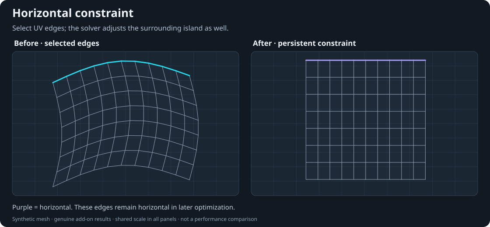
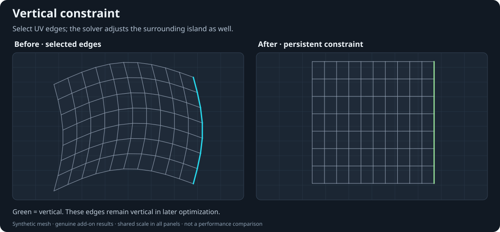
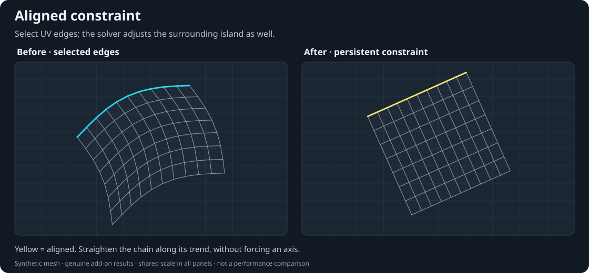
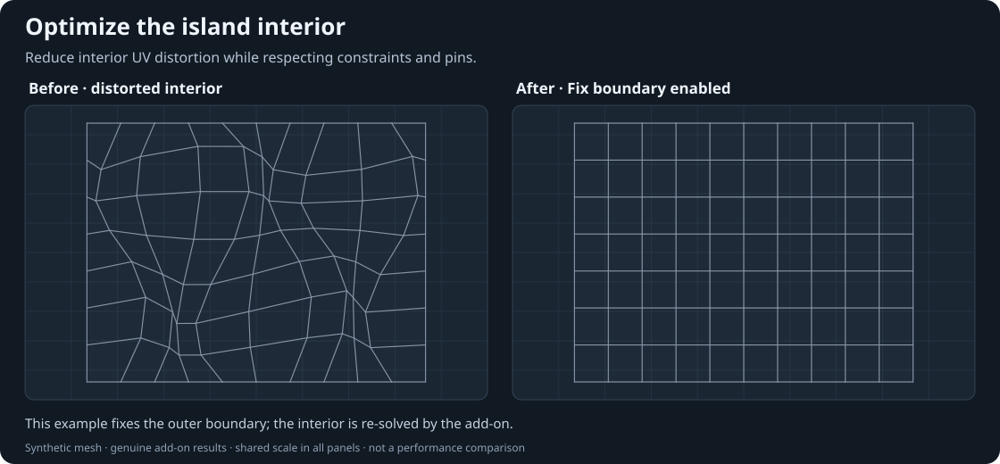
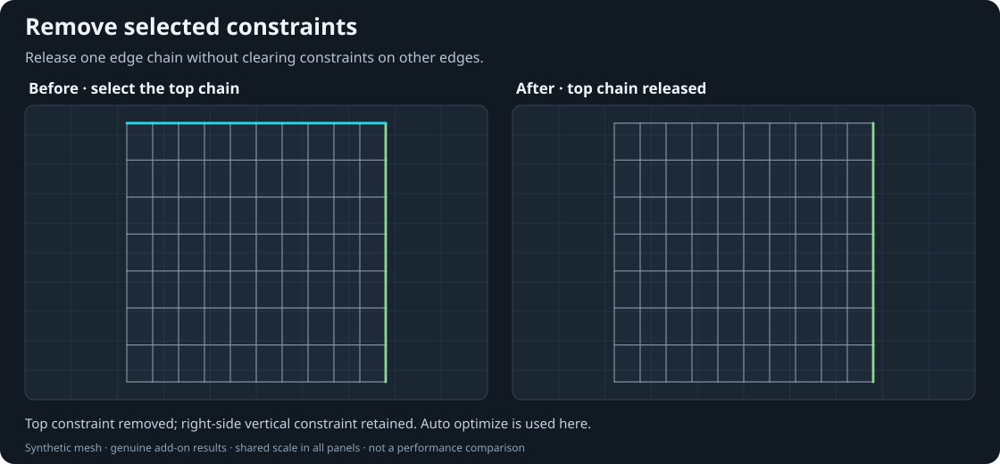
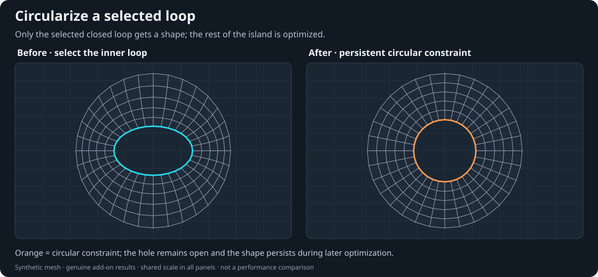
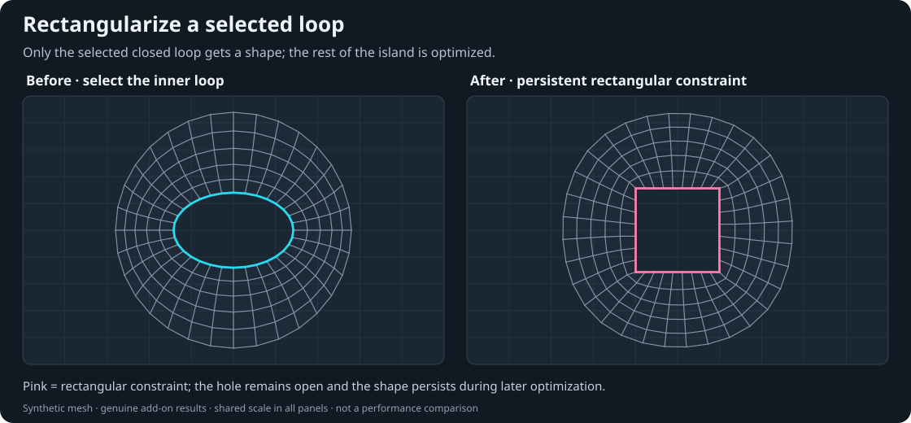
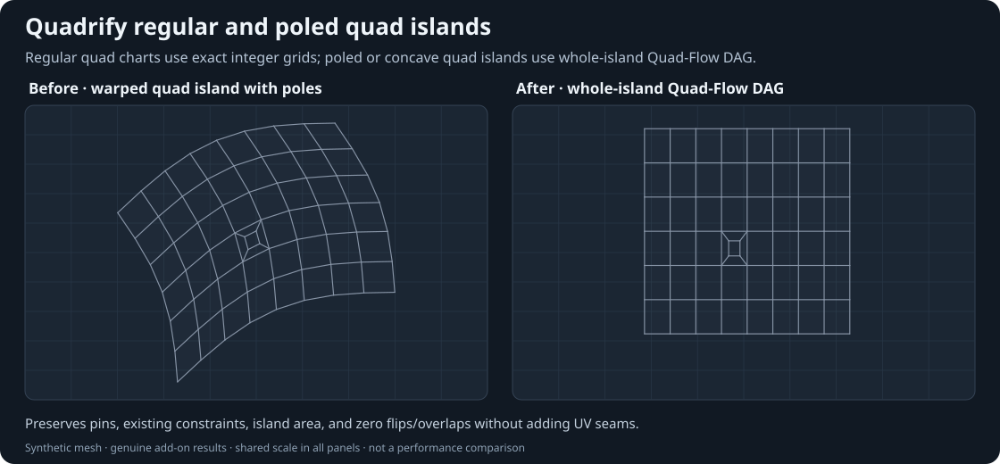
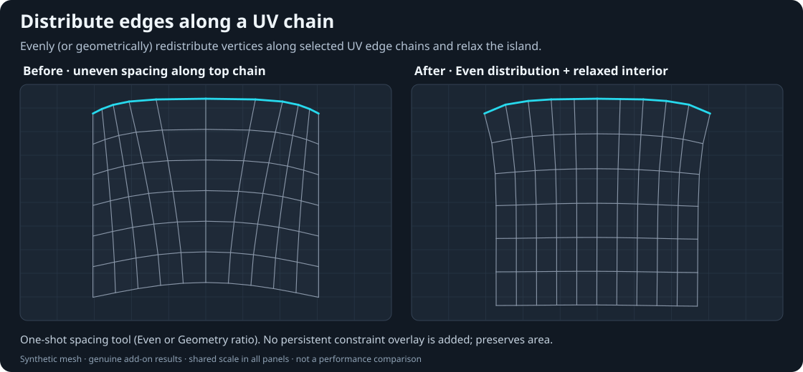
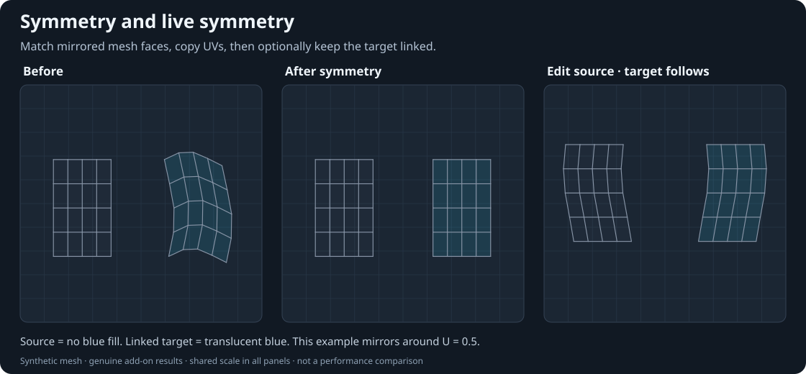

# UV Constraint Kit

[简体中文](README.zh-CN.md)

**Keep the UV edges you care about straight or shaped while the rest of the
island adjusts around them, inside Blender.**

> **Version 1.9.0 — Windows x64 CPU+GPU with native reader.**
> [Download the extension](https://github.com/goushi-1/uv-constraint-kit/releases/download/v1.9.0/uv_constraint_kit-1.9.0.zip)
> · [Validation scope](docs/VALIDATION.md).

Select an edge run and give it a horizontal, vertical or straight-line
constraint. Select a closed loop to make a circular opening or a rectangular
cutout. With **Optimize after marking** enabled, the affected island updates
when you add or remove a constraint. Constraints remain available for later
optimization, rather than being a one-time alignment.

The [1.9.0 release](https://github.com/goushi-1/uv-constraint-kit/releases/tag/v1.9.0)
provides **`uv_constraint_kit-1.9.0.zip`**. Requires **Blender 5.2+**.
[Package identity](release_checks.json).
[Known issues](docs/KNOWN_ISSUES.md).
Eligible large solves use the GPU automatically; small meshes and some special
solve paths stay on the CPU. GPU use requires an NVIDIA GPU with compute
capability **8.6+** (RTX 30/40/50 series; validated locally on RTX 40-series) and
a driver supporting CUDA 12.4+. The prebuilt extension does not require the CUDA
Toolkit. Other hardware and unsupported GPU setups use the CPU path. Published
builds remain in the [release history](https://github.com/goushi-1/uv-constraint-kit/releases).

## What changed in 1.9.0

- **Full GPU-resident mixed-precision solver (`compute_86`)**: Freshly compiled `gpu_metric.cu` PTX targeting `compute_86` (SM 8.6+, covering RTX 30/40/50; validated on local RTX 40-series) running an FP32 L-BFGS main sprint followed by a verified FP64 final exact polish directly in device memory (deterministic zero-atomic reductions, zero-sync L-BFGS scalar slots, same-device bitwise determinism `determinism_ok=true`, zero flips/self-overlaps, exact constraint residuals `<= 0.05°`).
- **Whole-island Quad-Flow DAG `Quadrify`**: Keeps regular pure-quad islands on the exact `quad_grid.py` integer-grid path and adds a whole-island acyclic Quad-Flow DAG solver for concave and pole-containing pure-quad islands (eliminating `"Different UV vertices occupy the same grid point"` on poled islands while preserving pins, existing user constraints, island area, and zero flips/overlaps), accelerated by `metric.py` run-pack caching and `quad_grid.py` batch UV reads. Partial pole-free quad-strip straightening remains available on mixed-polygon islands.
- **Upgraded `Circularize` & `Rectify` on holed and concave real meshes**: Unconstrained inner holes relax freely via virtual-hole-cap Tutte embeddings (with automatic intra-island overlap guard) instead of freezing at original UV coordinates, adaptive similarity scaling preserves exact `1e-5` island area (with bounded fallback when hard manual pins prevent exact area rescaling), ear/chord-safe DP corner selection dramatically boosts `Rectify` success rates on organic real meshes, and 3D Viewport sync-select (`use_uv_select_sync=True`, `uv_select_sync_valid=False`) falls back cleanly to selected mesh edges.
- **Per-island self-overlap-only `Prevent overlaps` solving**: Scopes `Prevent overlaps` strictly to intra-island self-overlaps across Optimize, Circularize, Rectify, Quadrify, and Distribute Edges (ignoring cross-island overlaps so independent islands stay in place before downstream UV packing), tries clean exact-subspace projection first under strict `0`-flip / `0`-self-overlap validation, and starts guarded soft-contact continuation gently (`st=1.0`) with post-convergence exact-subspace polish.
- **CPU / Reader / Python performance & UI polish**: Rebuilt `uvck_engine` (fused single-pass gradient eliminating `gu[4*nt]` traffic, dead-`sqrt` removal on reciprocal path, reusable contact-pair cache, `RecentTriangles`, `uvck_find_self_overlap_pair`, `uvck_filter_acyclic`, analytic CCD, `SoftMetric` up to `n <= 8192`) and stable-ABI `uvck_reader` (`PyObject_GetBuffer` raw `float[2]`/`double[2]` coordinate fast path + full batch read/write methods + Python fallback for `read_uv_select`), plus narrow-panel 2-row overlay controls in the sidebar.
- **Collapsible pre-mark Solve Presets drawer & `Distribute Edges` (`uv.uvck_distribute_edges`)**: Default-collapsed **Solve presets** drawer (`Prevent overlaps`, `Fix boundary`, `Use density map`) wired into marking, optimizing, and F9 defaults without changing Pie Menu operator IDs, plus one-shot **Even** / **Geometry** edge chain redistribution followed by safe island relaxation.
- **Blender 5.3.0 verification**: 49/49 member parity between `blender --command extension build` and `scripts/package.py --require-gpu --require-reader --require-numeric`. Passed 9/9 host tests (`test_v190_host.py` 11 cases covering UI/icon/i18n, poled Quadrify, self-overlap-only `Prevent overlaps`, stepped-border anti-foldback, `Distribute Edges`, free-hole `Circularize`/`Rectify`, ear-safe `Rectify`, 3D sync-select fallback, and pin-locked area fallback), 31-case (62-op) P2 quality gates (`hard_failures=0`, `soft_failures=0`, `0` overlaps/crossings/flips, `27/31` exact-zero mark residuals), 8-run CPU-0 pinned 12-op ABBA+BAAB (`determinism_ok=true`, `7.3209s` total median vs `1.7.62`'s `36.4286s` [`-79.90%`, `4.98x`] and `1.7.65`'s `29.8393s` [`-75.47%`]; `coastal mark` `2.3069s`, `coastal clear` `0.6371s`, `rocks mark` `2.5262s`, `rocks clear` `0.6060s`, `multi mark` `0.4167s`), and isolated `1.7.66 -> 1.9.0` upgrade/F9/CPU+GPU acceptance.

## Start with an existing UV layout

1. Install the release ZIP through **Preferences → Get Extensions → menu →
   Install from Disk**, then enable the extension. GitHub's **Code → Download
   ZIP** is repository source, not an installable extension.
2. Open an unwrapped mesh in **Edit Mode**. In the UV Editor, press **N** and
   open **UV Constraint**.
3. Use **Edge** selection mode and select only the UV edges you want to control.
   Turn **UV Selection Sync off** when you want just one side of a seam.
4. Apply a horizontal, vertical or straight-line constraint. For circularize
   or rectify, select a **complete closed edge loop**, rather than an open run.
5. Leave **Optimize after marking** on to see the island update, or turn it off
   to collect constraints and press **Optimize** when ready. **F9** adjusts the
   last operation. Select marked edges and use **Unconstrain** to release them.

You can constrain several separate runs without selecting the whole island.
The remaining UVs in the affected island adjust; an unselected gap between
runs does not receive an extra constraint.

## What each tool does

The before/after figures use synthetic meshes and actual plugin operations.
They explain the tools; they are not production-mesh acceptance evidence or
performance benchmarks.

### Horizontal constraints

Keep a selected run level in UV space. For example, mark the top and bottom
edges of a panel, then optimize its remaining UVs. Open runs and several
separate runs can be selected.



*Synthetic example: a selected run receives a horizontal constraint.*

### Vertical constraints

Keep a selected run upright. Combine horizontal and vertical constraints to
control the straight sides of a hard-surface part while its interior adjusts.
You do not have to mark every edge of the island.



*Synthetic example: a selected run receives a vertical constraint.*

### Straight-line constraints

Straighten a run along its current general direction, without forcing it onto
the horizontal or vertical axis. Use this for a slanted border that should be
straight while retaining its slant.



*Synthetic example: a selected run is straightened along its existing direction.*

### Optimize

Redistribute the UVs of the affected island with its edge and shape constraints
in place. Use it after moving UVs or collecting marks with automatic
optimization off. Pins and protection settings can limit which changes are
possible; incompatible results can be rejected.



*Synthetic example: fix the outer boundary and optimize the disturbed interior UVs.*

### Remove constraints

Select marked edges and use **Unconstrain** to release them. With automatic
optimization on, the island is solved again under the remaining constraints.
This frees the selected edges; it does not restore an earlier UV layout.
An empty edge selection leaves other constraints alone.



*Synthetic example: the selected constraint marks are removed.*

### Circularize

Select a complete closed loop and make it circular. The loop can surround an
opening **inside** an island, so it need not be the island's outer border.
Point spacing defaults to **Even**; F9 offers other spacing choices.

With automatic optimization on, the rest of the island adjusts around the
circle. The circular constraint is stored: shape another hole in the same
island, and earlier circles remain part of later optimization. With the switch
off, the target shape is recorded for the next Optimize operation.



*Synthetic example: a selected closed loop receives a circular constraint.*

### Rectify: rectangle or square

Select a complete closed loop to fit it to a rectangle. In F9, choose
**Target shape → Square** for equal sides. Like circularize, this stores a
constraint on the chosen opening or border and adjusts the rest of its island
when automatic optimization is on.

For a plate with several cutouts, shape one loop at a time. Existing circular
and rectangular constraints remain part of subsequent optimization, provided
the constraints and pins are compatible.



*Synthetic example: the selected hole boundary is constrained to a square.*

### Quadrify an island

Select part of a compatible quad island and use **Quadrify Island Grid** to
lay out that connected island as an axis-aligned quad grid. F9 controls face
proportions and averaging. This reorganizes the island's quad layout, rather
than only making a boundary rectangular.

The independent grid tool lays out regular all-quad charts (including compatible
grid holes) via an exact integer grid. Concave or pole-containing pure-quad
islands automatically fall back to whole-island acyclic Quad-Flow DAG
quadrification while preserving pins, existing constraints, island area, and
zero flips/overlaps. Mixed-polygon islands support straightening selected
pole-free quad strips while safely relaxing the rest; infeasible topologies are
rejected without a partial write.



*Synthetic example: a warped, rotated quad island containing interior poles is laid out cleanly via whole-island Quad-Flow DAG.*

### Distribute Edges

Select one or more UV edge chains and use **Distribute Edges** to redistribute
vertices along each chain evenly (**Even**) or in proportion to 3D mesh edge
lengths (**Geometry**), followed by safe relaxation of the rest of the island.
This is a one-shot spacing tool: it preserves pins, existing constraints, and
island area without adding persistent constraint overlays.



*Synthetic example: unevenly bunched vertices along the selected top chain are redistributed evenly while the interior relaxes.*

### Symmetry and live links

Mirror UVs between mesh faces matching across a chosen **local 3D symmetry
axis**. In F9, choose the UV direction and center; **By Cursor** uses the UV
cursor by default. Direct symmetry copies the layout and compatible
constraints once.

Enable **Live symmetry link** to keep the target following source edits or
optimization. Multiple groups can stay active with their own settings.
Matching sides can be separate UV islands or two parts of **one symmetric
island**. Tinted fill identifies linked targets; its color and opacity are
configurable in preferences.

Use **Stop symmetry link** to keep the current target UVs and transfer the
source's compatible constraints to the detached target. While linked, the
target follows source coordinates rather than being solved independently.



*Synthetic example: direct symmetry copies once; live symmetry keeps a target
following later source edits.*

## Scope and limitations

- With Selection Sync off, edge constraints can affect just one UV seam side.
  Visibility and selection determine the operation's scope.
- Circularize and rectify need complete closed loops. Open runs use the
  horizontal, vertical or straight-line tools.
- Constraint colors and line width are configurable. Colored overlays show
  stored constraints; selection highlighting identifies selected marks.
- Conflicting constraints, pins or protection settings can leave UVs unchanged.
  Conflicting or unsupported islands can be rejected.

This is an independent solver, not RizomUV's proprietary engine. Results,
convergence and performance can differ. The project is not affiliated with
Rizom-Lab, Blender, or the authors of its dependencies. See
[known issues](docs/KNOWN_ISSUES.md) and [validation scope](docs/VALIDATION.md).

## Building from source

Python handles Blender's interface, selection, undo and overlays; C++17 engines
handle numeric solves. Version 1.9.0 freshly rebuilds all native binaries: the
CPU engine (`engine.cpp`), CUDA GPU host and `compute_86` PTX (`engine_gpu.cpp`,
`gpu_driver.hpp`, `gpu_metric.cu`, `build_gpu.py`), stable-ABI reader
(`mesh_reader.cpp`), and `numeric_stage` (`numeric_stage.cpp`), supporting
`scripts/build_native.py --numeric` and `scripts/package.py --require-numeric`.
Native builds target **Windows x64 / MSVC**; host checks used Blender 5.3.0.
Building the CUDA engine from source requires CUDA Toolkit / NVRTC 12.4; the
prebuilt ZIP needs only a supported NVIDIA driver (SM 8.6+, CUDA 12.4+). The
reader uses Blender's bundled Python at runtime. Neither Python nor CUDA
runtime files are distributed. The commands below are a separate full-rebuild
recipe; any rebuilt artifact must be re-validated with its own recorded
identity.

```sh
python scripts/build_native.py --build-dir build/native_gpu_reader --gpu --reader --numeric --python-include "$PYTHON_INCLUDE" --python-library "$PYTHON_LIBRARY" --cuda-include "$CUDA_PATH/include" --nvrtc-dir "$CUDA_PATH/bin"
python tests/test_native.py --engine-dir build/native_gpu_reader/bin/windows-x64 --gpu
python scripts/package.py --native-dir build/native_gpu_reader/bin/windows-x64 --require-gpu --require-reader --require-numeric --output dist/uv_constraint_kit-1.9.0.zip
```

`--reader` requires `--python-include` containing `Python.h` and
`--python-library` pointing to the stable-ABI import library named
`python3.lib`. Do not pass a versioned library such as `python313.lib`.
`--require-reader` makes packaging fail if the reader binary or validated
metadata is missing. The reader is optional for other builds; those packages
retain the Python fallback.

A Python-only ZIP can still be built without `--native-dir`, using the slower
fallback. See [installation](docs/INSTALL.md) and [build instructions](docs/BUILD.md).

## Tests and limitations

```sh
python tests/test_native.py --engine-dir build/native/bin/windows-x64
blender --background --factory-startup --disable-autoexec --python-exit-code 1 --python tests/test_quad_grid_host.py
blender --background --factory-startup --disable-autoexec --python-exit-code 1 --python tests/test_host.py
blender --background --factory-startup --disable-autoexec --python-exit-code 1 --python tests/test_selection_host.py
blender --background --factory-startup --disable-autoexec --python-exit-code 1 --python tests/test_v190_host.py
```

Use disposable Blender processes. Tests create synthetic meshes and do not
save user scenes or preferences. CPU numerical tests need NumPy; Blender's
bundled Python already supplies it.

For packaged reader/GPU host checks and factory GUI acceptance, see [build
instructions](docs/BUILD.md) and [validation status](docs/VALIDATION.md). The
host checks verify backend routing and result agreement; they are not a
performance multiplier claim. Factory GUI testing used queued mouse-move events
to sample active G/R/S transforms and undo/redo. It does not cover manual mouse
input or a user's installed Blender environment. The 1.7.55 package checks and
their scope are listed in the validation record.

Read [known issues](docs/KNOWN_ISSUES.md) before production use. Exact integer-grid
quadrification handles regular pure-quad charts, the Quad-Flow DAG fallback extends
whole-island quadrification to concave and pole-containing pure-quad islands, and
mixed-polygon islands support straightening selected pole-free quad strips. GPU
execution is limited to eligible paths and does not guarantee a speedup.

## Versions

- 1.9.0 is the current release; adds full GPU-resident mixed-precision solving (`compute_86` SM 8.6+ PTX, `-79.90%` / `4.98x` vs `1.7.62`), whole-island Quad-Flow DAG `Quadrify`, upgraded holed/concave `Circularize` & `Rectify` (free inner holes, ear/chord-safe corners, 3D sync-select fallback), per-island self-overlap-only `Prevent overlaps` solving, rebuilt CPU/Reader/numeric binaries, collapsible pre-mark solve presets, and `uv.uvck_distribute_edges`, passing 9/9 host tests (`test_v190_host.py` 11 cases), P2 62-op, ABBA+BAAB, and isolated Blender 5.3.0 upgrade checks.
- 1.7.66 is the previous milestone introducing P3-E/P3-A/P3-B speedups and `build_native.py --numeric`.
- 1.7.65 is the previous published tag; its record is at the [v1.7.65 tag](https://github.com/goushi-1/uv-constraint-kit/blob/v1.7.65/release_checks.json).
- Earlier results are recorded separately in [validation](docs/VALIDATION.md).

## License

GNU GPL **3.0 or later**, without warranty. See [LICENSE](LICENSE) and
[third-party notices](THIRD_PARTY_NOTICES.md). The UniV-derived symmetry code
retains its copyright and license. The quadrification code is independently
implemented; the previous third-party adaptation is not published here.
