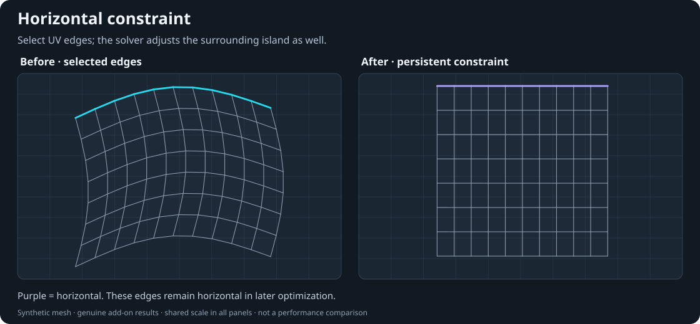
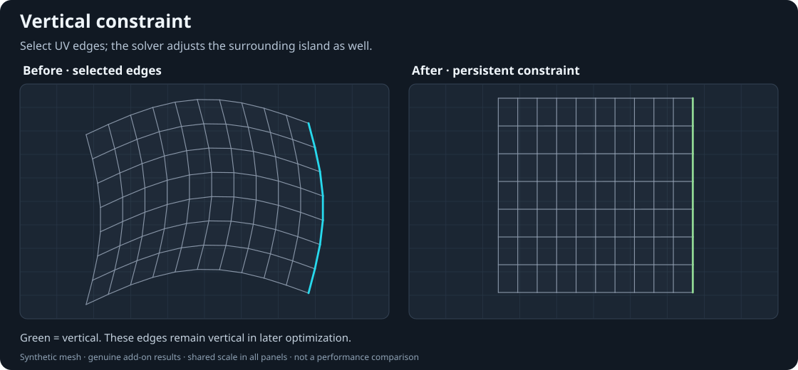
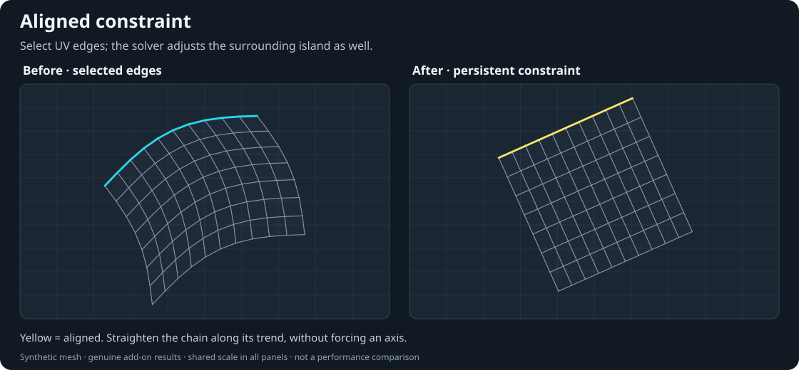
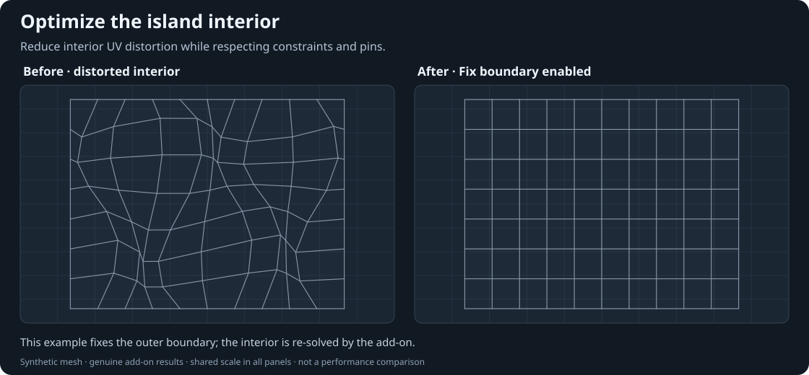
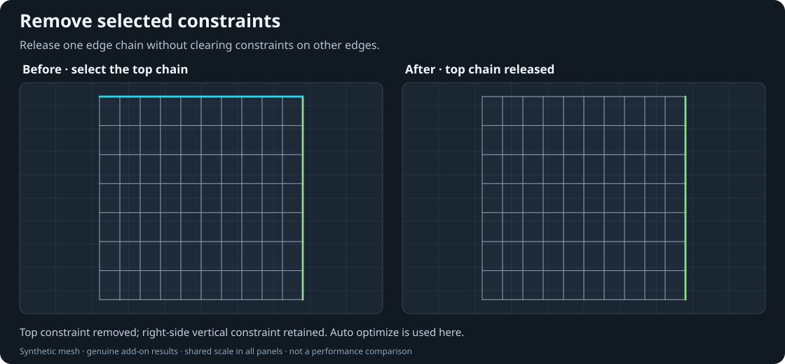
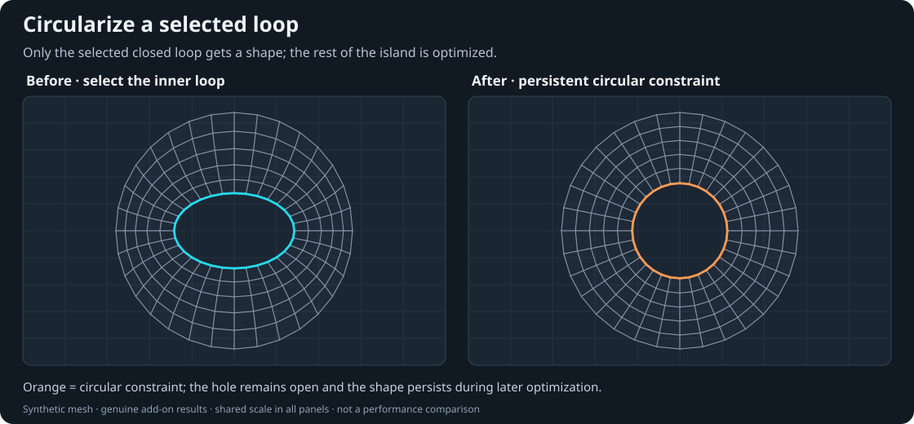
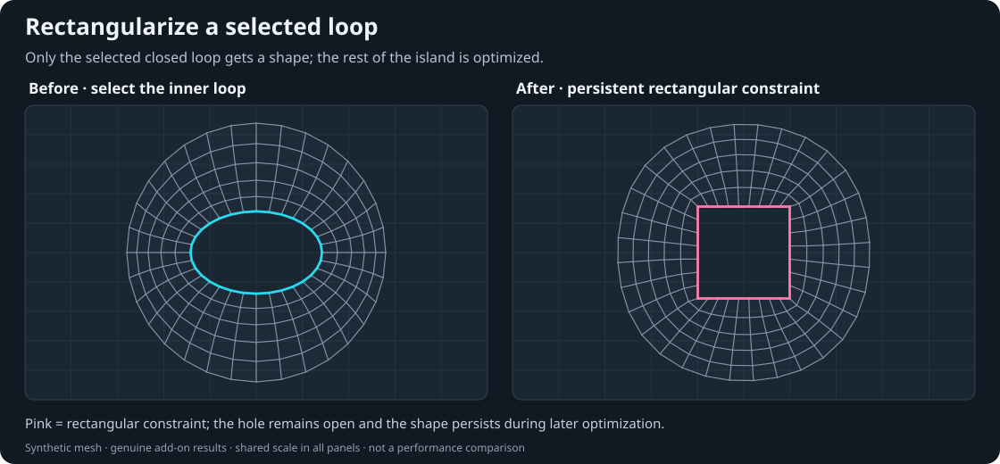
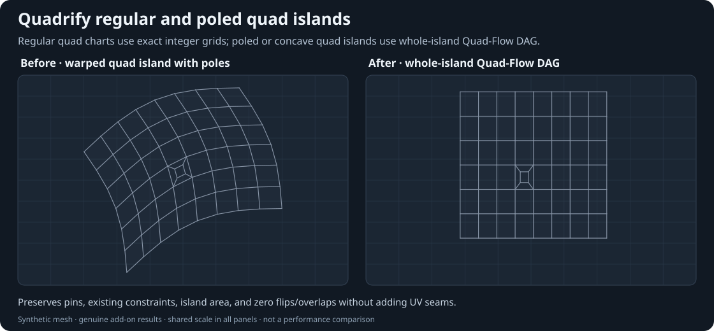
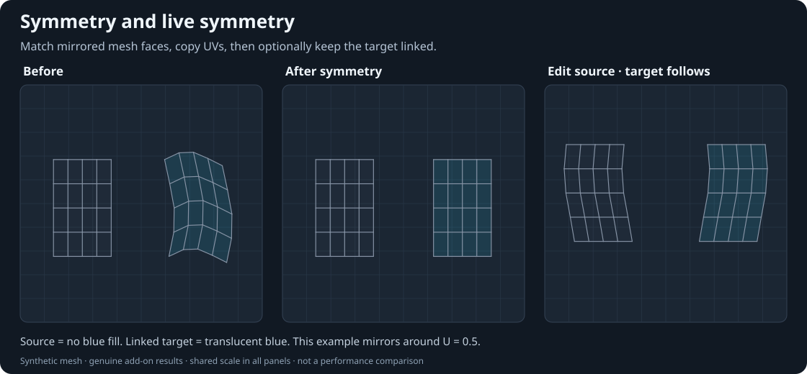

# UV Constraint Kit

[English](README.md)

**在 Blender 中，把需要控制的 UV 边保持为直线、圆形或方形，让岛屿其余部分围绕这些约束调整。**

> **1.9.0 正式版：Windows x64 CPU+GPU，附原生读取器。**
> [下载安装包](https://github.com/goushi-1/uv-constraint-kit/releases/download/v1.9.0/uv_constraint_kit-1.9.0.zip)
> · [查看验收范围](docs/VALIDATION.md)。

选中一段边，可以添加水平、垂直或直线约束；选中一个完整闭合环，可以把开孔变圆，
或把边界整理成长方形。开启「标记后自动优化」时，添加或解除约束后，相关 UV 岛会随之
优化。约束会保留下来，供后续优化继续使用，而不只是当次把选区对齐。

[1.9.0 发行页](https://github.com/goushi-1/uv-constraint-kit/releases/tag/v1.9.0)
提供 **`uv_constraint_kit-1.9.0.zip`**。需要 **Blender 5.2+**。
[安装包身份](release_checks.json)。
[查看已知问题](docs/KNOWN_ISSUES.md)。
符合条件的大型求解会自动使用 GPU；小网格和部分特殊求解仍使用 CPU。GPU 需要
NVIDIA 计算能力 8.9+ 显卡及支持 CUDA 12.4+ 的驱动。预构建扩展不需要另装 CUDA
Toolkit。其它硬件或不支持的 GPU 环境会使用 CPU 路径。
已发布的版本见[历史发行版](https://github.com/goushi-1/uv-constraint-kit/releases)。

## 1.9.0 的变化

- **整岛四边流 DAG 四边形化（`Quadrify`）**：规则纯四边形岛保持 `quad_grid.py` 精确整数网格路径；针对含内部极点与凹口的整块纯四边形岛，新增整岛无环四边流（Quad-Flow DAG）求解路径（解决 `"Different UV vertices occupy the same grid point"` 报错，严格保持固定点、用户已有约束、岛屿面积与零翻转/零重叠）；在混合多边形岛上仍保留局部无极点四边条带拉直路径。
- **高可靠「防止重叠」约束求解**：勾选「防止重叠」后保留软接触屏障与 `SoftMetric` 预条件器，并在软阶段收敛后补充精确子空间吸附；当未固定单岛已实现 0 自交、0 翻转且仅擦碰邻岛时，自动执行最小刚体平移避让，显著提升复杂凹岛开启防重叠时的约束成功率。
- **CPU / GPU / Python 全链路大幅提速**：重新编译 `uvck_engine`（零重哈希与亲和度感知多线程重叠检测、解析 CCD 边界步长、`n <= 8192` 启用 `SoftMetric`、L-BFGS 原地历史复用）与 `uvck_gpu` 宿主层（GPU 与锁页暂存缓冲跨阶段缓存、FNV-1a 常量复用、解析 CCD 边界步长），并向量化 `island_area` / `recovery` / `UVTopology` 与 `Quadrify` 的原生 `AcceptanceProbe` 安全检查。
- **默认折叠的「求解预设」抽屉**：在 UV 编辑器与 3D 视图侧边栏新增默认折叠的「求解预设」开关组（`防止重叠`、`固定边界条件`、`使用密度贴图`），自动作为标记与优化的默认参数且可由 F9 随时覆盖，不改变既有默认行为与外部饼菜单算子 ID。
- **边均匀分布（`uv.uvck_distribute_edges`）**：一次性轻量工具，支持沿选中 UV 边链按**等距分布**或**按模型边长**比例重新分布顶点，随后安全松弛岛屿其余部分；不新增持久约束类型与覆盖着色，保持固定点、既有约束与岛屿面积。
- **Blender 5.3.0 实测通过**：49/49 成员与 `blender --command extension build` 逐字节一致；9/9 宿主测试全过（含 `test_v190_host.py` 无头 UI/图标/汉化、含极点整岛 Quadrify、防重叠邻岛避让与边均匀分布）；31 用例（62 操作）P2 门禁全过（`hard_failures=0`、`soft_failures=0`、零重叠/零交叉/零翻转、`27/31` 精确零残差）；8 轮 CPU-0 绑核 ABBA+BAAB 确定性通过（`11.2343s` 总中位耗时，较 `1.7.62` 降 `67.71%` / 提速 `3.10x`，较 `1.7.65` 降 `62.35%`；`coastal mark` `3.5481s`、`rocks mark` `3.7499s`）；并完成 `1.7.66 -> 1.9.0` 隔离升级/F9/CPU+GPU 验收。

## 从已有 UV 开始

1. 在 Blender「偏好设置 → 获取扩展 → 菜单 → 从磁盘安装」中安装正式版 ZIP 并启用。
   GitHub「Code → Download ZIP」下载的是仓库源码，不能直接作为扩展安装。
2. 打开已经展开 UV 的网格，进入**编辑模式**。在 UV 编辑器按 **N**，打开
   **UV Constraint** 面板。
3. 切换到 UV **边选择模式**，只选需要控制的边。只处理接缝一侧时，先关闭
   **UV 选择同步**。
4. 添加水平、垂直或直线约束。使用圆形化或方形化时，应选中**完整闭合边环**，
   而不是一段开口边链。
5. 开启「标记后自动优化」立即查看岛屿变化；关闭后可以先集中标记，再点击「优化」。
   **F9** 调整上次操作参数。选中已标记的边，点击「解除约束」即可释放。

不必选中整个岛屿，也可以同时标记几段互不相连的边。优化器调整相关岛屿的其它 UV，
不会因为两段边之间存在间隔，就给未选中的间隔边补上约束。

## 各项功能

以下前后对照图使用合成网格，并由插件实际执行操作生成。图片用于解释功能，
不代表所有生产模型都已验收，也不是性能测试结果。

### 水平约束

让选中的一段边在 UV 中保持横平。例如为面板上沿、下沿添加水平约束，再优化周围 UV。
可以只选一段开口边链，也可以同时选择几段互不相连的边。



*合成示例：为选中的边链添加水平约束。*

### 垂直约束

让选中的一段边保持竖直。整理硬表面部件时，可以组合水平和垂直约束，控制需要拉直的
边界，同时允许内部 UV 调整；不需要把岛屿每条边都标记一遍。



*合成示例：为选中的边链添加垂直约束。*

### 直线约束

沿边链原来的大致方向把它拉直，不强制改为水平或垂直。适合需要保留倾斜方向、
但希望排列为直线的斜边。



*合成示例：选中的边链沿原有大致方向整理为直线。*

### 优化

在保留边约束和形状约束的条件下，重新调整相关岛屿的 UV 分布。手动移动 UV 后，
或关闭自动优化、集中添加了多组约束后，都可以使用它。固定点和其它保护设置会限制
可行的变化；约束不相容时，结果可能被拒绝。



*合成示例：固定外边界，优化被扰动的内部 UV。*

### 解除约束

选中已标记的边，点击「解除约束」。自动优化开启时，岛屿会按剩余约束重新求解。
这项操作释放选中的约束，并不是恢复某个旧 UV 布局。边选区为空时，不会清空其它约束。



*合成示例：移除所选边上的约束标记。*

### 圆形化

选中一个完整闭合边环，将它约束为圆形。这个环可以是**岛屿内部的开孔**，
不必是整个岛屿的外边界。默认使用**均匀**点间距，F9 可以切换其它间距方式。

自动优化开启时，岛屿其余部分围绕圆形调整。圆形约束会被保存：同一个岛有多个孔洞时，
可以继续处理下一个孔，后续优化仍保留之前的圆形约束。关闭自动优化时，先记录目标
形状，下一次执行「优化」再应用。



*合成示例：为选中的闭合边环添加圆形约束。*

### 方形化：长方形或正方形

选中完整闭合边环，将它整理为长方形；需要等长四边时，在 F9 中把「目标形状」
切换为「正方形」。它与圆形化一样，只为选中的开孔或边界保存形状约束，
自动优化开启时同时调整岛屿其它部分。

例如一块带有多个开孔的面板，可以逐个处理闭合环。只要形状约束和固定点互相兼容，
已有的圆形、方形约束会继续参与后续优化。



*合成示例：将选中的孔边界约束为正方形。*

### 四边形化

选中兼容的纯四边形 UV 岛中的一部分，使用「四边形化」把整个相关岛屿排列为对齐坐标轴的
四边形网格。F9 可以调整面比例和平均方式。它会整理岛屿的网格排列，与只把边界变成
长方形的「方形化」不同。

独立整数格算法支持规则纯四边形岛（包括拓扑兼容的网格孔洞）；遇到含内部极点或凹口的
整块纯四边形岛时，自动切换至无环四边流（Quad-Flow DAG）整岛求解路径，并严格保持固定点、
已有约束、岛屿面积与零翻转/零重叠；混合多边形岛屿支持选中无极点四边条带局部拉直并安全
松弛其余面，不可行输入安全拒绝且不产生半写。



*合成示例：将拓扑兼容的四边形岛排列为网格。*

### 对称与实时联动

依据选定的**模型局部三维对称轴**，匹配两侧网格面并对称 UV。在 F9 中选择 UV 方向和
中心；默认开启「以 UV 光标为中心」。直接对称会一次性复制布局和可兼容的约束。

开启「实时联动」后，编辑或优化源侧，目标侧会跟随更新。可以同时保持多组联动，
各组保存自己的设置。匹配的两侧既可以是两个 UV 岛，也可以位于**同一个对称 UV 岛内**。
联动目标有填充颜色提示，颜色和透明度可在偏好设置中调整。

点击「解除联动」会保留目标当前的 UV，并把源侧可兼容的约束复制给目标。
联动期间，目标使用源侧的对称坐标，不作为另一份独立约束参与求解。



*合成示例：直接对称复制一次；实时对称继续跟随源侧后续编辑。*

## 作用范围与限制

- 关闭 UV 选择同步后，可以只对接缝一侧添加边约束。可见性和选区决定操作范围。
- 圆形化、方形化要求完整闭合边环。开口边链使用水平、垂直或直线约束。
- 约束颜色和线宽可调整；彩色叠加线显示已保存的约束，选中高亮用于辨认当前选区。
- 约束、固定点或保护设置冲突时，UV 可能保持不变。预览版不保证能求解任意岛屿。

这是独立求解实现，不包含 RizomUV 的专有引擎，不保证结果、收敛或性能一致。
本项目与 Rizom-Lab、Blender 或依赖项目作者没有隶属关系。
请阅读[已知问题](docs/KNOWN_ISSUES.md)和[验收范围](docs/VALIDATION.md)。

## 从源码构建

Python 负责 Blender 界面、选区、撤回和叠加层，C++17 引擎负责数值计算。1.9.0 重新编译了 CPU 引擎（`engine.cpp`）、CUDA GPU 宿主库（`engine_gpu.cpp`、`gpu_driver.hpp`）与 `numeric_stage`，沿用经源校验未改动的 `1.7.66` CUDA PTX（`gpu_metric.cu`）与原生读取器（`mesh_reader.cpp`），并继续支持 `scripts/build_native.py --numeric` 与 `scripts/package.py --require-numeric`。原生构建面向
**Windows x64 / MSVC**；宿主检查使用 Blender 5.3.0。从源码构建 CUDA 引擎需要
CUDA Toolkit / NVRTC 12.4；预构建包只需要兼容 NVIDIA 驱动。读取器运行时使用
Blender 自带 Python；发行包不包含 Python 或 CUDA 运行时文件。
以下命令是独立的完整重建示例；任何重新编译的制品均需重新验收并记录身份。

```sh
python scripts/build_native.py --build-dir build/native_gpu_reader --gpu --reader --numeric --python-include "$PYTHON_INCLUDE" --python-library "$PYTHON_LIBRARY" --cuda-include "$CUDA_PATH/include" --nvrtc-dir "$CUDA_PATH/bin"
python tests/test_native.py --engine-dir build/native_gpu_reader/bin/windows-x64 --gpu
python scripts/package.py --native-dir build/native_gpu_reader/bin/windows-x64 --require-gpu --require-reader --require-numeric --output dist/uv_constraint_kit-1.9.0.zip
```

`--reader` 必须同时提供 `--python-include`（其中有 `Python.h`）和
`--python-library`（stable ABI 导入库 `python3.lib`）。不要传入
`python313.lib` 这类版本专用导入库。`--require-reader` 会在读取器二进制或校验元数据缺失时
拒绝打包。其它构建可以不启用读取器，并保留 Python 回退路径。

不传 `--native-dir` 仍可生成仅 Python 的安装包，使用速度较慢的回退路径。
详见[安装说明](docs/INSTALL.md)和[构建说明](docs/BUILD.md)。

## 测试与限制

```sh
python tests/test_native.py --engine-dir build/native/bin/windows-x64
blender --background --factory-startup --disable-autoexec --python-exit-code 1 --python tests/test_quad_grid_host.py
blender --background --factory-startup --disable-autoexec --python-exit-code 1 --python tests/test_host.py
blender --background --factory-startup --disable-autoexec --python-exit-code 1 --python tests/test_selection_host.py
blender --background --factory-startup --disable-autoexec --python-exit-code 1 --python tests/test_v190_host.py
```

测试只生成合成网格，请在独立工厂配置进程中运行；不保存用户场景或偏好。
原生数值测试需要 NumPy，可使用 Blender 自带 Python。

打包读取器／GPU 宿主检查和工厂 GUI 验收范围见[构建说明](docs/BUILD.md)和
[验收记录](docs/VALIDATION.md)。宿主检查用于核对后端分派和结果一致性，不代表性能倍数承诺。
工厂 GUI 检查通过排队的鼠标移动事件检查活动中的 G/R/S 变换及撤回／重做；
不包含人工鼠标输入或用户安装环境。1.7.55 最终包检查和验收范围见验收记录。

使用前请阅读[已知问题](docs/KNOWN_ISSUES.md)。规则纯四边形岛走精确整数网格四边形化，含极点与凹口的整块纯四边形岛自动走四边流 DAG 整岛求解，混合面岛屿可选中无极点四边条带局部拉直并松弛其余面。GPU 只用于符合条件的求解路径，不保证提速。

## 版本区分

- 1.9.0 为当前正式版：新增整岛四边流 DAG `Quadrify`、高可靠「防止重叠」接触求解与自动邻岛避让、重建 CPU/GPU/Python 全链路提速（较 `1.7.62` 降 `67.71%` / `3.10x`）、默认折叠「求解预设」抽屉与 `uv.uvck_distribute_edges`，完成 9/9 宿主测试、P2 62 操作（0 硬/软失败）、8 轮 ABBA+BAAB 与隔离 Blender 5.3.0 升级验收。
- 1.7.66 为上一里程碑（P3-E/P3-A/P3-B 提速与 `build_native.py --numeric`）。
- 1.7.65 为上一公开标签发行版，其记录见 [v1.7.65 标签](https://github.com/goushi-1/uv-constraint-kit/blob/v1.7.65/release_checks.json)。
- 更早结果分别记录在[验收记录](docs/VALIDATION.md)。

## 许可

GNU GPL **3.0 或后续版本**，不提供担保。见 [LICENSE](LICENSE) 及
[第三方声明](THIRD_PARTY_NOTICES.md)。UniV 改编对称部分保留版权与许可；
四边形化为独立实现，旧第三方改编模块不公开。
