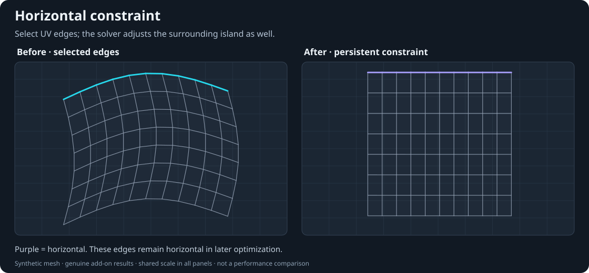
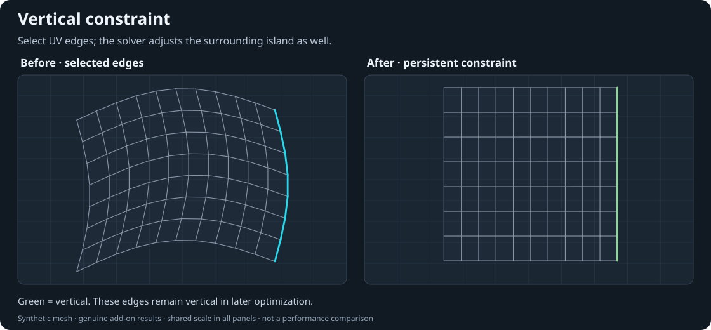
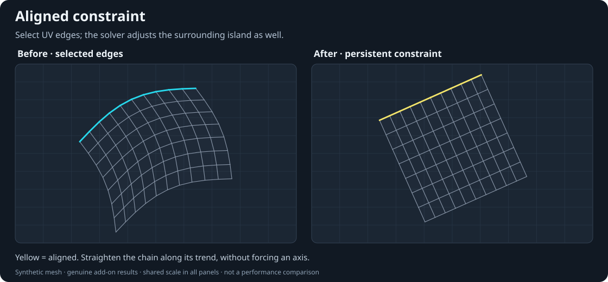
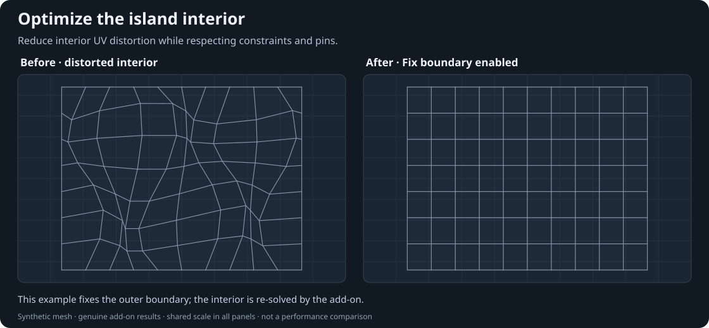
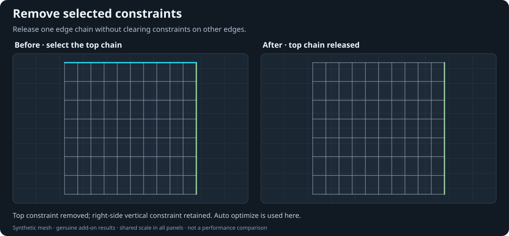
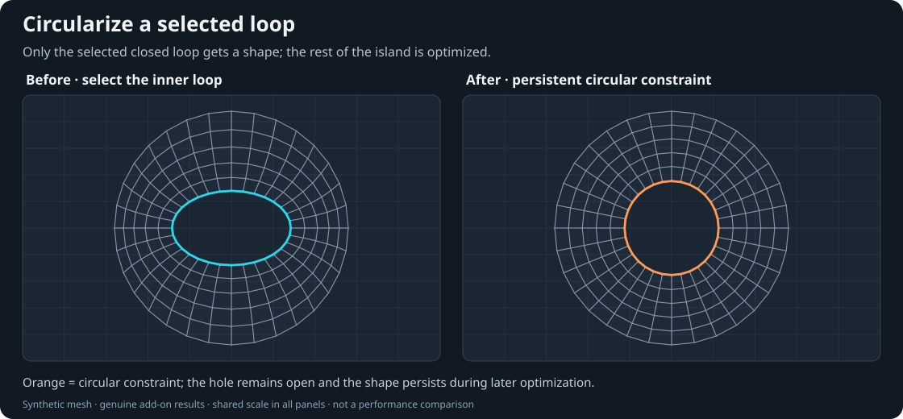
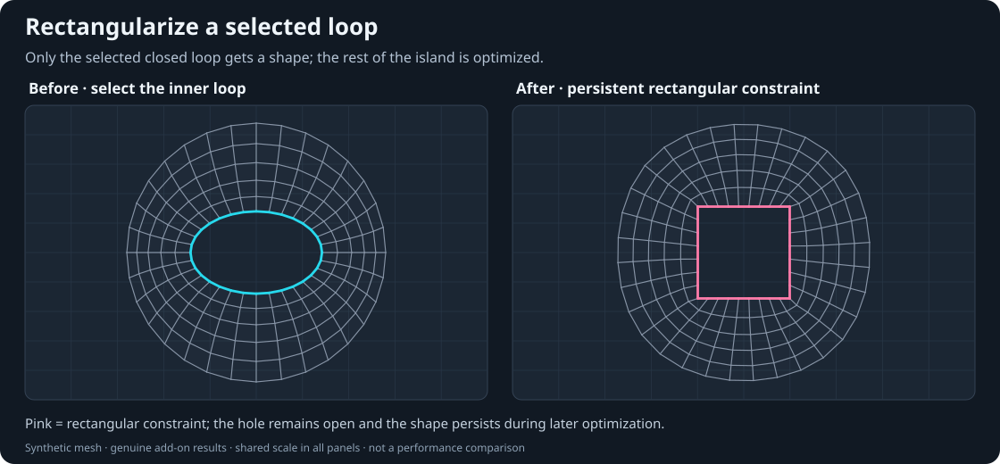
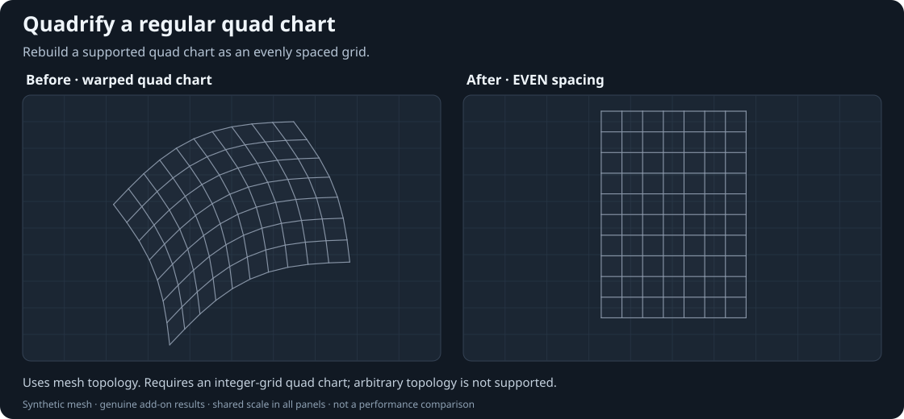
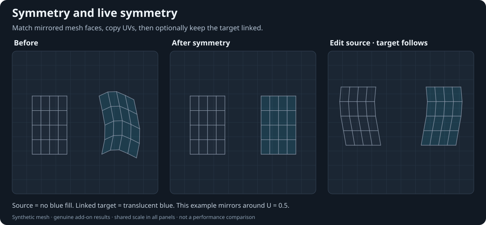

# UV Constraint Kit

[English](README.md)

**在 Blender 中，把需要控制的 UV 边保持为直线、圆形或方形，让岛屿其余部分围绕这些约束调整。**

选中一段边，可以添加水平、垂直或直线约束；选中一个完整闭合环，可以把开孔变圆，
或把边界整理成长方形。开启「标记后自动优化」时，添加或解除约束后，相关 UV 岛会随之
优化。约束会保留下来，供后续优化继续使用，而不只是当次把选区对齐。

[下载 Windows x64 CPU 预览版](https://github.com/goushi-1/uv-constraint-kit/releases/tag/v1.7.42-preview.1)
—— 在 Release 附件中选择 **`uv_constraint_kit-1.7.42-preview.zip`**。
需要 **Blender 5.2+**。当前是**预览版，并非稳定发行版**，请先在工作副本上使用。
[查看已知问题](docs/KNOWN_ISSUES.md)。

## 从已有 UV 开始

1. 在 Blender「偏好设置 → 获取扩展 → 菜单 → 从磁盘安装」中安装预览 ZIP 并启用。
   GitHub「Code → Download ZIP」下载的是仓库源码，不能直接作为扩展安装。
2. 打开已经展开 UV 的网格，进入**编辑模式**。在 UV 编辑器按 **N**，打开
   **UV Constraint** 面板。
3. 切换到 UV **边选择模式**，只选需要控制的边。只处理接缝一侧时，先关闭
   **UV 选择同步**。
4. 添加水平、垂直或直线约束。使用圆形化或方形化时，应选中**完整闭合边环**，
   而不是一段开口边链。
5. 开启「标记后自动优化」立即查看岛屿变化；关闭后可以先集中标记，再点击「优化」。
   **F9** 调整上次操作参数。选中已标记的边，点击「解除约束」即可释放。

不必选中整个岛屿，也可以同时标记几段互不相连的边。优化器调整相关岛屿的其它 UV，
不会因为两段边之间存在间隔，就给未选中的间隔边补上约束。

## 各项功能

以下前后对照图使用合成网格，并由插件实际执行操作生成。图片用于解释功能，
不代表所有生产模型都已验收，也不是性能测试结果。

### 水平约束

让选中的一段边在 UV 中保持横平。例如为面板上沿、下沿添加水平约束，再优化周围 UV。
可以只选一段开口边链，也可以同时选择几段互不相连的边。



*合成示例：为选中的边链添加水平约束。*

### 垂直约束

让选中的一段边保持竖直。整理硬表面部件时，可以组合水平和垂直约束，控制需要拉直的
边界，同时允许内部 UV 调整；不需要把岛屿每条边都标记一遍。



*合成示例：为选中的边链添加垂直约束。*

### 直线约束

沿边链原来的大致方向把它拉直，不强制改为水平或垂直。适合需要保留倾斜方向、
但希望排列为直线的斜边。



*合成示例：选中的边链沿原有大致方向整理为直线。*

### 优化

在保留边约束和形状约束的条件下，重新调整相关岛屿的 UV 分布。手动移动 UV 后，
或关闭自动优化、集中添加了多组约束后，都可以使用它。固定点和其它保护设置会限制
可行的变化；约束不相容时，结果可能被拒绝。



*合成示例：固定外边界，优化被扰动的内部 UV。*

### 解除约束

选中已标记的边，点击「解除约束」。自动优化开启时，岛屿会按剩余约束重新求解。
这项操作释放选中的约束，并不是恢复某个旧 UV 布局。边选区为空时，不会清空其它约束。



*合成示例：移除所选边上的约束标记。*

### 圆形化

选中一个完整闭合边环，将它约束为圆形。这个环可以是**岛屿内部的开孔**，
不必是整个岛屿的外边界。默认使用**均匀**点间距，F9 可以切换其它间距方式。

自动优化开启时，岛屿其余部分围绕圆形调整。圆形约束会被保存：同一个岛有多个孔洞时，
可以继续处理下一个孔，后续优化仍保留之前的圆形约束。关闭自动优化时，先记录目标
形状，下一次执行「优化」再应用。



*合成示例：为选中的闭合边环添加圆形约束。*

### 方形化：长方形或正方形

选中完整闭合边环，将它整理为长方形；需要等长四边时，在 F9 中把「目标形状」
切换为「正方形」。它与圆形化一样，只为选中的开孔或边界保存形状约束，
自动优化开启时同时调整岛屿其它部分。

例如一块带有多个开孔的面板，可以逐个处理闭合环。只要形状约束和固定点互相兼容，
已有的圆形、方形约束会继续参与后续优化。



*合成示例：将选中的孔边界约束为正方形。*

### 四边形化

选中兼容的纯四边形 UV 岛中的一部分，使用「四边形化」把整个相关岛屿排列为对齐坐标轴的
四边形网格。F9 可以调整面比例和平均方式。它会整理岛屿的网格排列，与只把边界变成
长方形的「方形化」不同。

独立整数格算法支持规则纯四边形岛，包括拓扑兼容的网格孔洞。遇到极点、混合多边形、
非流形连接或无法一致展开的网格闭环时，会保持原 UV，不输出局部结果。
它不能保证适用于任意拓扑。



*合成示例：将拓扑兼容的四边形岛排列为网格。*

### 对称与实时联动

依据选定的**模型局部三维对称轴**，匹配两侧网格面并对称 UV。在 F9 中选择 UV 方向和
中心；默认开启「以 UV 光标为中心」。直接对称会一次性复制布局和可兼容的约束。

开启「实时联动」后，编辑或优化源侧，目标侧会跟随更新。可以同时保持多组联动，
各组保存自己的设置。匹配的两侧既可以是两个 UV 岛，也可以位于**同一个对称 UV 岛内**。
联动目标有填充颜色提示，颜色和透明度可在偏好设置中调整。

点击「解除联动」会保留目标当前的 UV，并把源侧可兼容的约束复制给目标。
联动期间，目标使用源侧的对称坐标，不作为另一份独立约束参与求解。



*合成示例：直接对称复制一次；实时对称继续跟随源侧后续编辑。*

## 作用范围与限制

- 关闭 UV 选择同步后，可以只对接缝一侧添加边约束。可见性和选区决定操作范围。
- 圆形化、方形化要求完整闭合边环。开口边链使用水平、垂直或直线约束。
- 约束颜色和线宽可调整；彩色叠加线显示已保存的约束，选中高亮用于辨认当前选区。
- 约束、固定点或保护设置冲突时，UV 可能保持不变。预览版不保证能求解任意岛屿。

这是独立求解实现，不包含 RizomUV 的专有引擎，不保证结果、收敛或性能一致。
本项目与 Rizom-Lab、Blender 或依赖项目作者没有隶属关系。
请阅读[已知问题](docs/KNOWN_ISSUES.md)和[验收范围](docs/VALIDATION.md)。

## 从源码构建

Python 负责 Blender 界面、选区、撤回和叠加层，C++17 引擎负责数值计算；仓库包含可选的
CUDA Driver API 引擎源码。上面的下载包包含 **CPU 引擎**，并不是 GPU 版本。
原生构建目前面向 **Windows x64 / MSVC**，本次公开版宿主验证使用 Blender 5.2.3。

```sh
python scripts/build_native.py
python scripts/package.py --native-dir build/native/bin/windows-x64 --output dist/uv_constraint_kit.zip
```

不传 `--native-dir` 可生成仅 Python 的安装包，使用速度较慢的回退路径。
详见[安装说明](docs/INSTALL.md)和[构建说明](docs/BUILD.md)。

## 测试与限制

```sh
python tests/test_native.py --engine-dir build/native/bin/windows-x64
blender --background --factory-startup --disable-autoexec --python-exit-code 1 --python tests/test_quad_grid_host.py
blender --background --factory-startup --disable-autoexec --python-exit-code 1 --python tests/test_host.py
blender --background --factory-startup --disable-autoexec --python-exit-code 1 --python tests/test_selection_host.py
```

测试只生成合成网格，请在独立工厂配置进程中运行；不保存用户场景或偏好。
原生数值测试需要 NumPy，可使用 Blender 自带 Python。

使用前请阅读[已知问题](docs/KNOWN_ISSUES.md)。新四边形化对极点、不一致拓扑
闭环和混合多边形可能安全拒绝。GPU 并不加速所有步骤，不能用局部引擎计时
代替完整操作计时。

## 版本区分

- `main`：1.7.42 预览版，包含独立四边形化和间隔边选区修复。
- `experimental/numeric-trials`：1.7.43 实验分支，受保护求解的中间坐标留在
  数组中，尚未证明稳定的整体提速。
- 历史本地正式版本与隔离基线见[验收记录](docs/VALIDATION.md)，原始资产、
  用户场景与历史测试转储不进入仓库。

## 许可

GNU GPL **3.0 或后续版本**，不提供担保。见 [LICENSE](LICENSE) 及
[第三方声明](THIRD_PARTY_NOTICES.md)。UniV 改编对称部分保留版权与许可；
四边形化为独立实现，旧第三方改编模块不公开。
